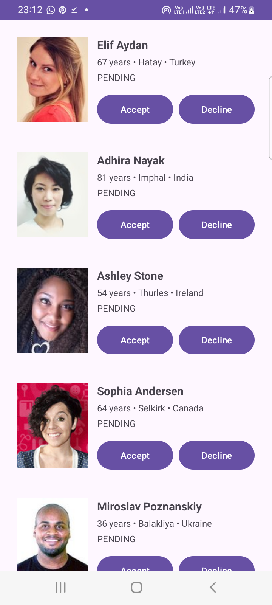

# MatchMateApp V2 - corrected assignment version

# Matrimony App - Android Clean Architecture

A modern Android matrimony app built with Clean Architecture, Room Database, Dagger Hilt, and Retrofit. The app follows best practices for separation of concerns, dependency injection, and data management.

## 🛠 Tech Stack & Specifications
* **Language:** Kotlin
* **UI Layer:** XML + Data Binding / View Binding
* **Architecture:** MVVM + Clean Architecture
* **Networking:** Retrofit + OkHttp
* **Local Database:** Room (Single source of truth)
* **Dependency Injection:** Hilt
* **Image Loading:** Glide
* **Features:** Full offline support & persistent user action state (Accept/Decline)

---

## Architecture Overview

The app follows Clean Architecture, divided into three main layers:

1. **Data Layer**
    - API interfaces (Retrofit)
    - Room DB interfaces (DAO)
    - Entity models (DB and Network)
    - Repository implementations
    - Data sources (Local and Remote)
    - Pagination & Mapping

2. **Domain Layer**
    - Business logic
    - Use cases
    - Repository interfaces

3. **Presentation Layer**
    - Views (Activities, Fragments)
    - ViewModels
    - UI components (Adapters, Custom Views)
    - Dependency Injection setup

## Data Flow

The app follows a unidirectional data flow:

1. **Service Interface** (`MatchesApiService` for API or Daos for DB)
2. **Paging Sources** (`MatchRemoteMediator`)
3. **Repository** (Single source of truth, connects Data and Domain layers)
4. **Use Cases** (Business logic implementation)
5. **ViewModel** (Holds and manages UI-related data)
6. **Flow/LiveData** (Emits data changes to UI)
7. **Views** (Displays data and handles user interactions)

## Key Components

### Data Layer
- `MatchApiService`: Retrofit interface for API calls
- `MatchUserDao,RemoteKeysDao`: Room database access interface
- `MatchRepositoryImpl`: Repository implementation

### Domain Layer
- `MatchRepository`: Repository interface
- Use cases (e.g., `GetMatchesUseCase`, `UpdateMatchStatusUseCase`)

### Presentation Layer
- `MatchMateViewModel`: ViewModel for UI data
- `MainActivity`: UI components
- Custom views and adapters

## V2 
- DTO, Domain Model and Room Entity are separated.
- Room is the single source of truth for the UI.
- Paging 3 + RemoteMediator are used for API pagination.
- Existing users' ACCEPTED/DECLINED status is preserved when API data is refreshed.
- New users default to PENDING.
- Network errors are exposed through Paging LoadState while existing Room data remains available offline.
- UI only talks to the ViewModel.
- ViewModel talks to UseCases.
- UseCases depend on the domain repository interface.
- Repository owns data-source coordination.

## 📸 Screenshots

